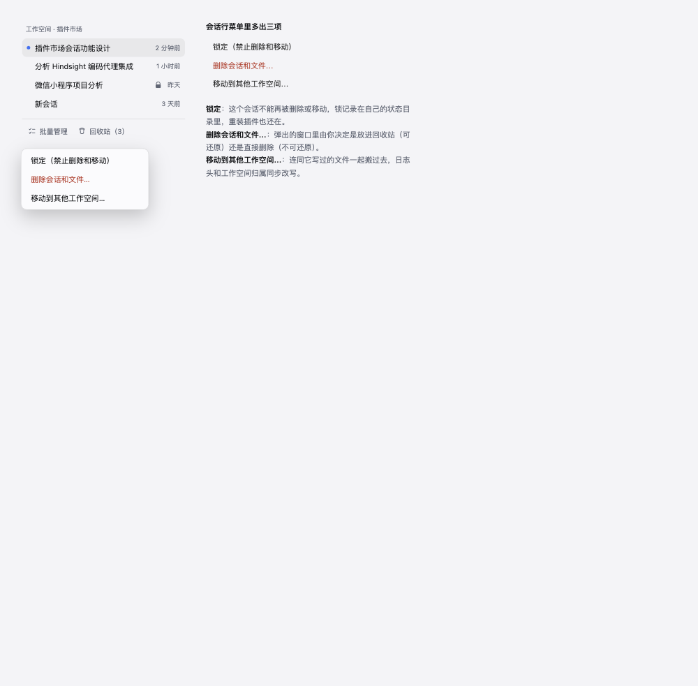
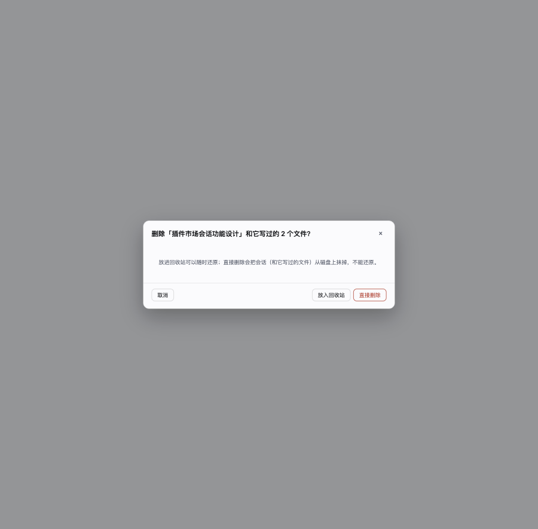
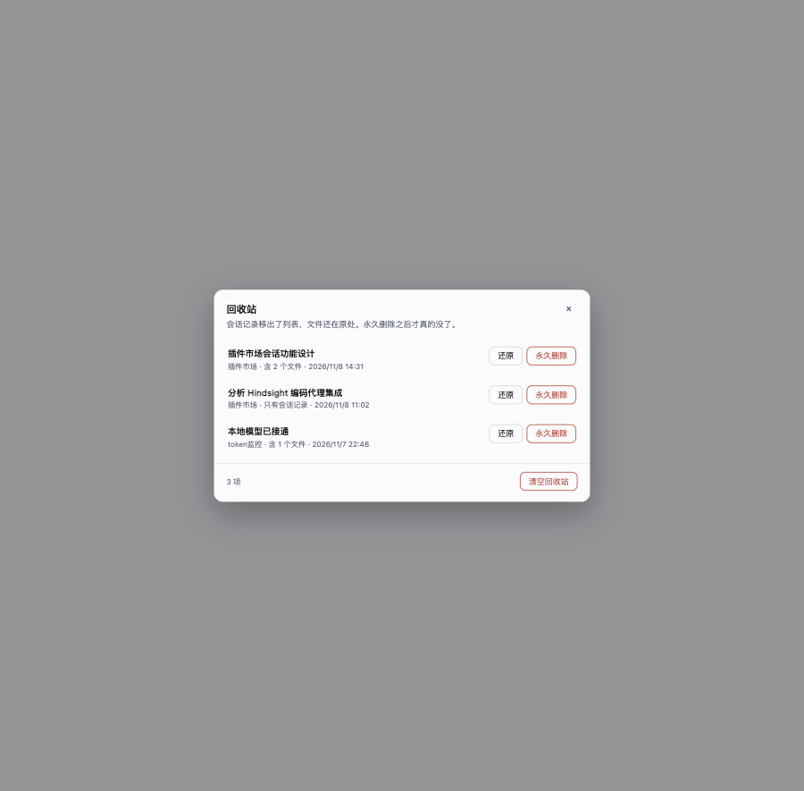
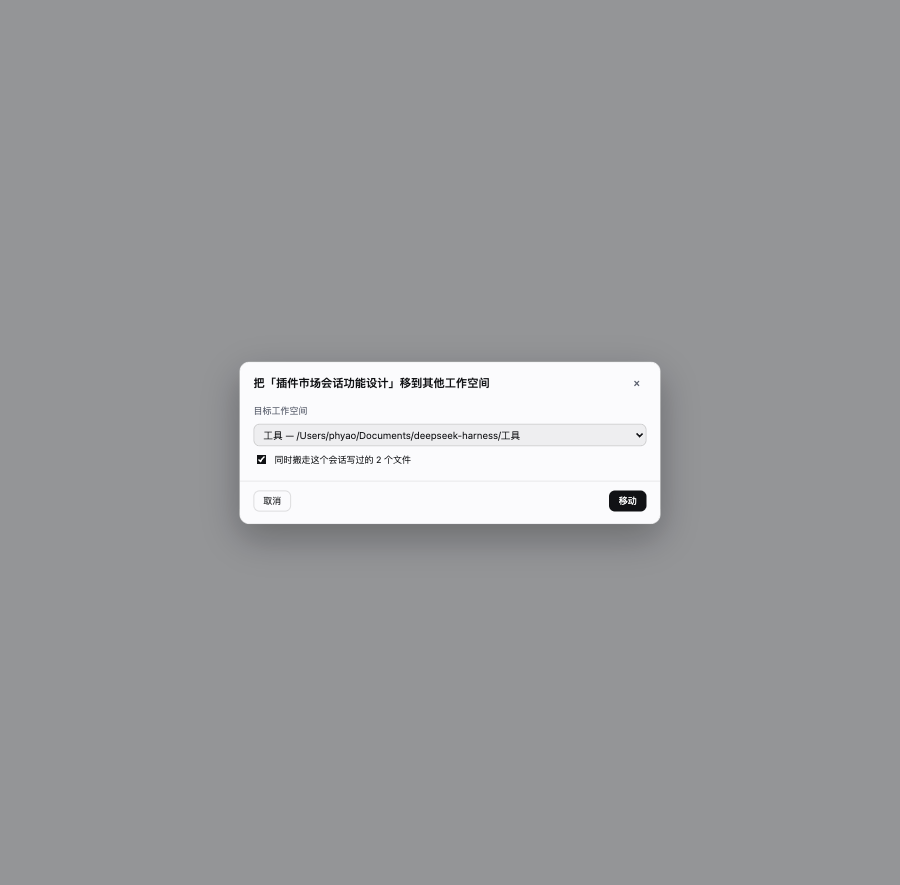
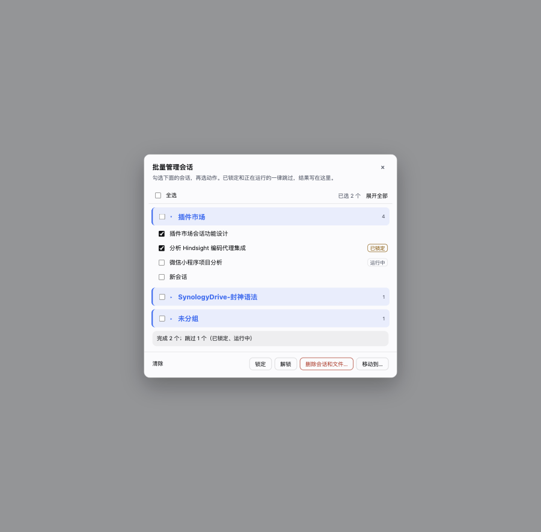
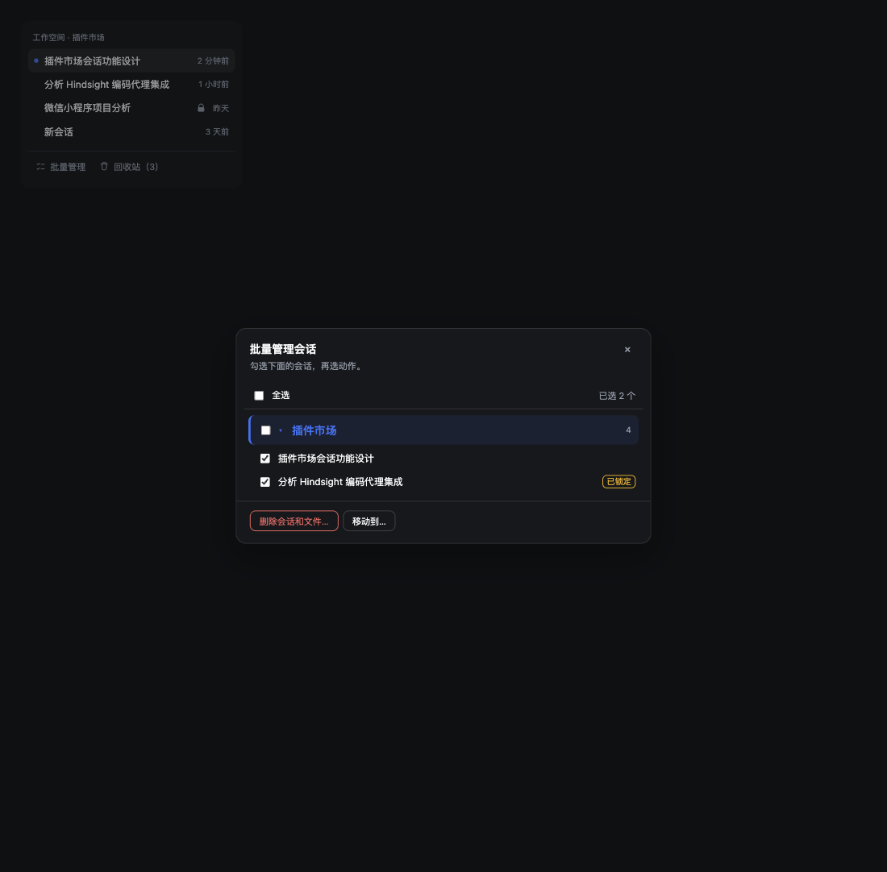

# 会话管理（dsh-session-tools）

左侧会话列表的补充操作：**锁定**、**回收站**、**移动**。
所有删除都是「先放回收站」，永久删除是唯一不可撤销的一步，并且只在回收站里提供。

## 界面一览

### 会话行菜单与锁标记

### 删除时由你决定去哪里

### 回收站

### 把会话连同文件搬到另一个工作空间

### 按工作空间分组的批量管理

### 深色主题

## 出现在哪里

| 位置 | 内容 |
|---|---|
| 某条会话行的「⋯」菜单 | 锁定 / 解锁、删除会话和文件…、移动到其他工作空间… |
| 会话行尾部 | 已锁定的会话显示一把锁 |
| 侧栏底部（设置旁边） | 回收站入口，带条数 |
| 浮层 | 回收站面板、移动对话框、确认对话框、结果提示 |

## 列表里的「新会话」是什么

是**空壳会话**：只写了日志头、没有一条消息、也没有标题的会话目录（通常 300–900 字节）。
你在某个工作空间点过一次「新建会话」、或者启动时被自动创建过一个草稿，但它从头到尾没用过，就留下这么一个目录。
它不是插件造出来的东西——`~/.dsh/sessions/<工作空间>/<会话 id>/` 里真实存在，工作空间也真的把它记在名下，
所以侧栏本来也会把它显示成「新会话」。

插件之前把这些行叫「未命名会话」，是因为 Host 只知道"没有标题"、不知道"根本没内容"。
现在面板会对没有缓存标题的会话读一次它自己的日志：**有消息但没标题** 才叫「未命名会话」，
**只有一个头** 叫「新会话」，跟侧栏同一个词。这些空壳正是批量清理最合适的目标，勾上直接删除即可。

## 「正在运行」是按什么判断的

不看"会话在内存里"——侧栏把打开过的会话都留在内存里，那样只要有会话开着就永远删不掉。
现在问的是 DSH 自己的活动通道 `workspace/session-activity`（就是归档功能用的那个）：
有进行中的回合、子代理、后台任务、定时任务才算「运行中」，提示里会说明是哪一类。
**空闲但开着的会话可以删**，删完页面会收到通知把行去掉。

## 批量管理

侧栏底部的「批量管理」打开一个面板。列表**按工作空间折叠分组**：每个工作空间一行标题（带条数、组内全选、展开箭头），
点标题展开才看到里面的会话；顶部还有「全选 / 展开全部 / 已选 N 个」。每个会话左边是方框，点整行也能勾。
（这份列表由 Host 从工作空间归属 + 会话目录直接给出，不依赖页面传下来的数据。）勾选后一次处理多个：

- **锁定 / 解锁**：批量改锁。
- **删除会话和文件…**：先给出这次涉及多少文件，再让你选**放入回收站**还是**直接删除**。
- **移动到…**：选目标工作空间，可选是否连文件一起搬。

批量里**不会因为一个会话被拒就整体失败**：已锁定的、正在运行的、已在回收站里的会被跳过，
其余照常完成，结果条写成「完成 N 个；跳过 M 个（已锁定、运行中）」。
面板只处理你勾选的会话；子代理会话（会话列表本身不显示的）不进这个列表。

## 四种操作各自的含义

- **锁定**：这个会话不能再被删除、移动。锁的记录在 `~/.dsh/session-tools/state.json`，
  重装插件也还在。它不会阻止你正常对话，也拦不住 DSH 自带的「归档」——归档只是隐藏，不删东西。
- **移到回收站**：会话的日志目录从会话库移到回收站，列表里就不见了。
  工作空间里的文件一个都不动。可以「还原」，还原会把它放回原来的工作空间和原来的位置。
- **删除会话和它产生的文件**：在上一项的基础上，把**这个会话写过的文件**也一起搬进回收站。
  「写过」= 会话日志里 `write` / `edit` / `apply_patch` 记录到的、位于该会话工作空间内的文件。
  它不会删别的会话的文件，也不会删它没写过的文件。还原时文件回到原来的绝对路径。
- **移动到其他工作空间**：把会话连同它写过的文件搬到目标工作空间，**会话本身也真的换了归属**：
  日志第一帧里的 `cwd` 被改写为目标工作空间路径，日志目录移动到目标工作空间的会话目录，
  Workspace 注册表里的归属同步改写。所以重启之后索引出来的结果和当前一致，不会「自己跳回去」。

  目标目录里已有同名文件时，那个文件留在原处不动，结果提示会说明有几个文件被跳过。

## 为什么「移动」要改写日志头

DSH 判断「这个会话属于哪个工作空间」的唯一依据是
`realpath(会话头.cwd) === 工作空间.path`（`@deepseek-ai/dsh-workspace`）。
只改注册表不改日志头，重启后该会话会被成员校验过滤掉、从列表里消失。
所以移动会重写日志的**第一帧**（头行）并把后面所有帧原样抄过去 —— 追加式日志不重建，
事件一条不少（测试里对真实会话校验过：434 条事件前后完全一致）。

## 出问题时

- 回收站面板里的「还原」是完整的回退：日志目录、文件、工作空间归属都回去。
- 插件的自有状态只有一个文件：`~/.dsh/session-tools/state.json`；
  回收站里的东西在 `~/.dsh/session-tools/trash/<条目 id>/`。
- 移动途中断电或报错时，插件会把已经动了的部分退回去，并报「已撤销」，不会留下半个会话。
- 改工作空间需要运行环境的 zstd 支持（Node 22.15+/24 自带）。没有时「移动」会明确说明原因。

## 删完为什么列表会马上消失

侧栏的行不是从磁盘现读的：会话目录（`api-session/added|removed`）由 Session Controller 维护，
而它只在「会话被 dispose」时把行删掉；被本插件搬进回收站的会话永远不会被 dispose。
所以插件在删除/永久删除后按 Controller 自己的格式补发 `api-session/removed`，
还原时补发 `api-session/added`（summary 用 Controller 自己的 `summarizeCold` 生成，形状一致）。
插件重新加载时还会对回收站里的存量条目补发一次，用来清掉「操作已完成但页面没刷新」的旧行。

## 已知边界

- 正在运行的会话不能删除或移动 —— 先停它。
- 移动不会重写会话里已经记录的历史绝对路径；插件用 `state.json` 里的 `relocations`
  链把「以前写过的文件」映射到当前位置，这也是「移动 → 再移回」能完整往返的原因。
- 会话日志被外部删除（磁盘上已经不存在）而列表里还挂着条目时，「移到回收站」可以把这个残留条目清掉。
